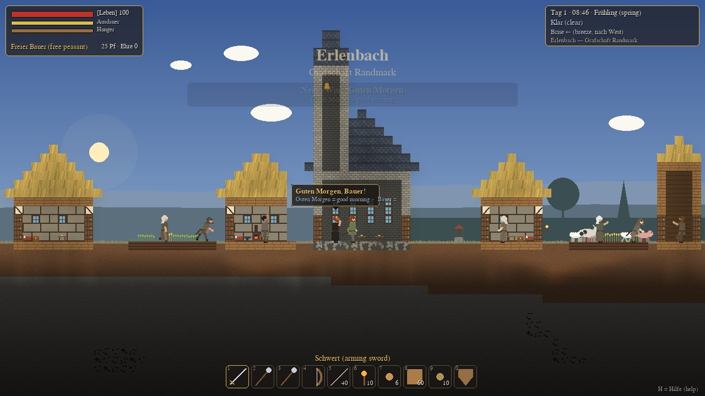
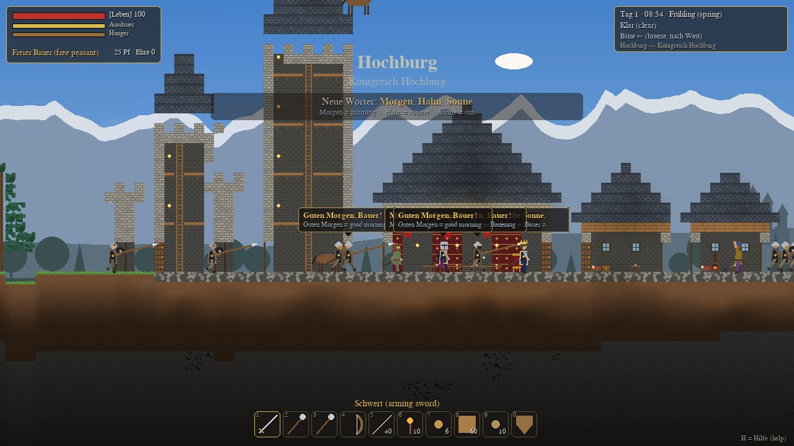
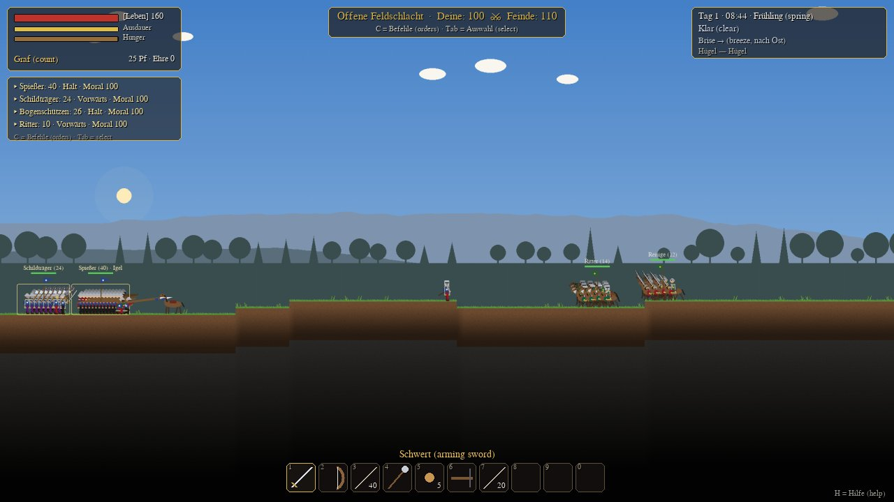
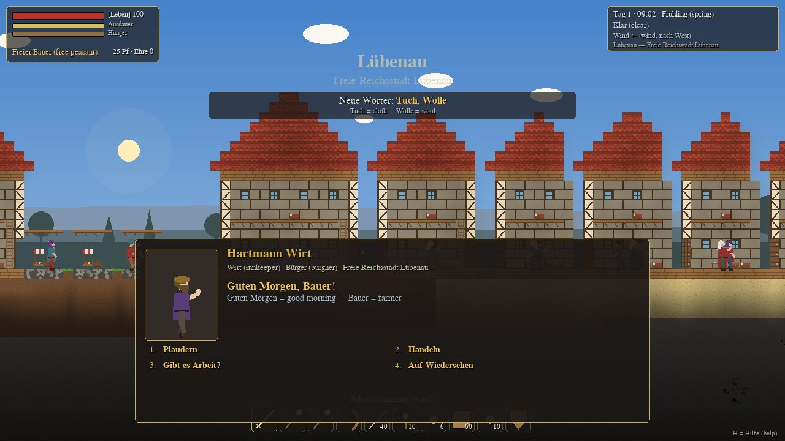
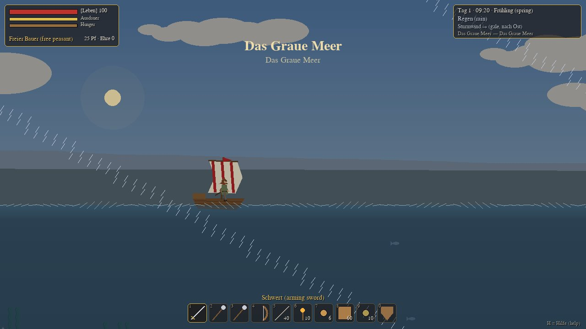
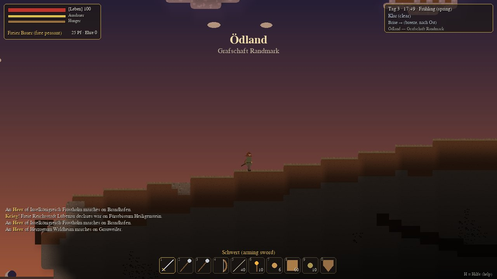
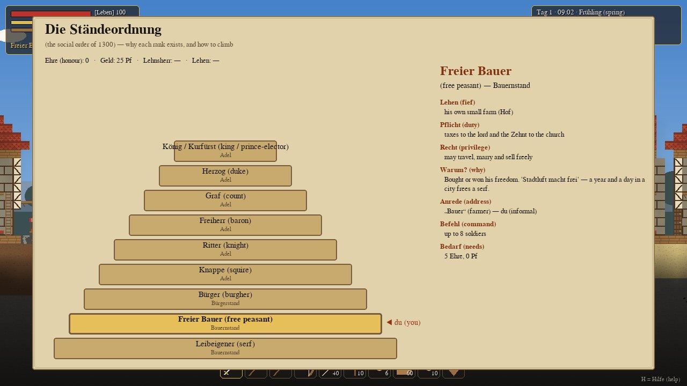
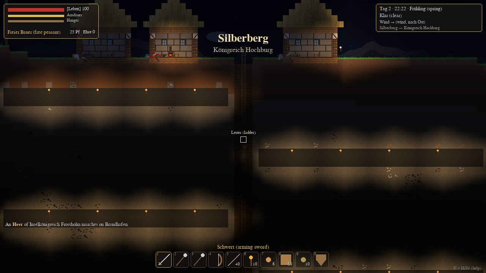
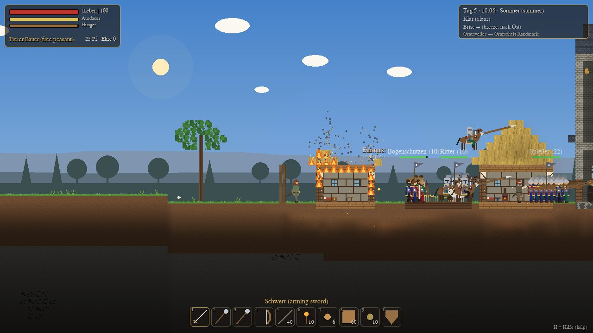

# WARLORD — Anno 1300

A 2D medieval **simulation** sandbox set in a fictional Holy Roman Empire, 1300 AD — built in Python with pygame.
Seven realms lie on a strip of land between two ends of the world: **the Abyss** in the west, where the earth
breaks off into nothing, and **the Fire Sea** in the east, where it melts away. Riding from one end to the other
takes about an hour.

You start in the mud as a serf and can climb the **Ständeordnung** (the social order) to knight, baron, count —
while every NPC speaks a mix of English and **German** you can learn from (every word goes into your *Wörterbuch*).



| | |
|---|---|
|  |  |
|  |  |
|  |  |
|  |  |

## Run it

```bash
pip install pygame-ce numpy
```

```bash
python main.py
```

Python 3.10+. Classic `pygame` 2.x also works. F11 toggles fullscreen, F3 shows the frame rate.

## Three ways to play

- **Geschichte** (Story) — *Die Chronik des Konrad*, 7 chapters: from serf of Erlenbach at the brink of the
  world, through the free city of Lübenau ("Stadtluft macht frei"), squire, knighthood, a voyage across the Grey
  Sea, a great battle and the election of the Kaiser — and why the Abyss keeps growing.
- **Sandkasten** (Sandbox) — the open world in three sizes (15 / 30 / 60 minutes of riding end to end).
- **Feldschlacht** (Field battle) — four set pieces: hold a ford, defend a mountain gate, an open battle of
  knights vs. pikes, and storming a robber knight's castle.

## Controls

| Key | Action |
|---|---|
| A / D, Shift, S, Space, W | walk, run, crouch (run + crouch = slide), jump, climb / swim up |
| Left mouse / J | attack — the move depends on your state (see Combat) · mine / place / eat with tools, blocks, food |
| Right mouse / K | block — tap it just before a hit lands to **parry** |
| E | talk, doors and gates, chests, beds, mount a horse, board a boat, harvest, pray, read signposts |
| 1–0 / mouse wheel | hotbar · Q drop · T cycle shield / armour / helmet · V fire arrows |
| I · B · M · N · R | inventory & crafting · blueprints · world map · Wörterbuch (Q = quiz) · Ständeordnung |
| C · Tab · Z | formation orders · select formation · commander's zoomed-out view |
| F5 / F9 · Esc · H | save / load · pause · help |

## What's in the world

**Seven realms of different sizes** (their rulers are the seven *Kurfürsten*, the electors):

| Realm | Type | Land | Ruler |
|---|---|---|---|
| Randmark | Grafschaft (county) | wasteland at the Abyss, meadows | Graf Randolf |
| Waldheim | Herzogtum (duchy) | deep forest, bog, a robber knight's castle | Herzog Eberhard |
| Hochburg | Königreich (kingdom) — the largest | mountains, silver mines, the crag-castle | König Albrecht |
| Heiligenstein | Fürstbistum (prince-bishopric) | vineyards, monastery, cathedral town | Fürstbischof Wolfram |
| Lübenau | Freie Reichsstadt (free city) | coast, port, salt | Bürgermeister Witte |
| Frostholm | Inselkönigreich (island kingdom) | across the Grey Sea: snow, fjords | Königin Sigrun |
| Glutmark | Markgrafschaft (march) | ash, basalt, volcanoes, the Fire Sea | Markgraf Otto der Rote |

- **Tile world with a smooth look.** 48 000 × 256 tiles (a 1-hour ride), generated in ~4 s. Natural tiles get
  rounded corners where they face open air, so hills look soft instead of blocky. Caves, ores (coal, iron, silver
  in Hochburg, salt, gold, *Glutstein* near the lava), underground lava, lakes, an ocean with a sandy, gravelly
  seabed full of seaweed, shells and shipwrecks with loot.
- **The ends of the world.** In the west the land is a crumbling slab hanging over the void, with floating stones
  above it and gravity that weakens near the brink. Fall in, and after a few seconds the sky drops you back into
  the world somewhere else. Enemies you knock into the Abyss sometimes come back the same way. In story mode the
  brink keeps crumbling. In the east a sea of lava pours off the edge.
- **Settlements, built from parts:** Fachwerk (timber-frame) houses with thatched or tiled roofs, two-storey
  burgher houses, churches with bell towers, windmills, smithies with anvil and forge, taverns, markets, wells,
  fields, palisades, town walls with gates, castles (keep, towers, curtain walls, great hall with throne and
  banners), monasteries, mine shafts, harbour docks, and signposts between villages.
- **A living environment:** day and night, four seasons, wind, clouds, rain, storms with lightning that sets trees
  alight, fog and snow. Crops ripen (faster in rain, never in winter), grass spreads, saplings grow into trees,
  orphaned leaves decay. Fire spreads through thatch and timber, faster downwind, and villagers run to put it out.
  Water and lava flow and turn into obsidian where they meet. Sand falls, and **built structures need support**:
  dig out a wall's foundation and it collapses (sapping).
- **The sea:** buy a *Kogge* (cog) in a port. Wind from behind fills the sail; against it you crawl or row. A
  full sail in a storm can capsize you. Swimming has buoyancy and breath, and heavy armour drags you down.
- **Building and crafting:** mine and place single tiles, Terraria-style, or use **blueprints** (huts, burgher
  houses, smithies, mills, wells, walls, gates, watchtowers, chapels, knights' halls, a whole castle) that
  builders raise tile by tile. About 60 recipes at the Werkbank, Amboss + Esse, Ofen and Webstuhl.

## Combat

**One button, several moves.** What your attack does depends on what you're doing:

| State | Move |
|---|---|
| standing | 3-hit combo: cut, backswing, heavy overhead |
| running | lunge / charge |
| crouching | low sweep, or a **Konter** (riposte) right after a successful block |
| in the air | plunging strike |
| on horseback | couched lance / riding slash, damage grows with speed |

Blocking costs stamina and posture. A **parry** (block in the last instant) staggers the attacker for free.
Crouching makes you a smaller target: high swings pass over you.

**Weapons that play differently:** the sword parries well · the axe smashes shields and fells trees · the mace
ignores armour · the dagger stabs ×3 into an unaware back · spears and pikes brace against charges (crouch + block)
but are clumsy up close · the halberd hooks riders off their horses · the flail wraps around shields · bows draw
with the mouse and drift on the wind (rain wets the string) · crossbows are slow but punch through mail · torches
light the dark and set thatch on fire. Armour (gambeson, mail, coat of plates) protects differently against cut,
pierce and blunt, and slows you down.

## Mid- to large-scale battles: the *Haufen*

A side view has no room for armies spread across a field, so the game borrows the historical **Gewalthaufen**: a
block of soldiers becomes **one formation entity**, drawn in several depth ranks (pseudo-3D). Only the **front
rank are real fighters** who duel the enemy front with the same combat rules as you. Behind them, every soldier is
a lightweight record that:

- **steps forward** when a front man falls, so the line holds as long as bodies remain;
- **rotates in** on *Wechsel!* so the wounded can rest (good troops do this by themselves);
- adds **pressure** (push of pike: the stronger block shoves the weaker back) and morale;
- extends **reach** (pike ranks 2 and 3 stab past the front);
- can be **shot by volleys**, **trampled by a charge**, or **cut down from behind** if you flank it.

Morale falls with losses, flanking and arrows, and recovers near the leader. When it breaks, the Haufen
**routs**. Formations that run into a gate or wall **hack through it** (siege). Hundreds of soldiers fight at
full frame rate, and Z gives you a zoomed-out commander's view.

**Orders, shouted in German:** *Vorwärts* (advance), *Halt* (hold), *Angriff* (charge), *Zurück* (fall back),
*Schildwall* (shield wall: arrows bounce off), *Igel* (hedgehog: braced pikes stop horses dead), *Keil* (wedge:
breaks lines), *Locker* (loose order: volleys miss), *Salve* (volley), *Wechsel* (rotate), *Mir nach* (follow
me), *Formiert euch* (your loose followers merge into a Haufen), *Auflösen* (disperse).

**Troop types:** peasant levy, spearmen, sword-and-shield men, pikemen, halberdiers, archers, crossbowmen with
pavises, mounted men-at-arms and knights. Each counters something and is countered by something.

## Society

- **NPCs live their lives:** they sleep in their own beds, work by day and gather at the tavern in the evening.
  Farmers really harvest and re-sow the wheat tiles, woodcutters fell real trees, smiths hammer, priests pray,
  guards patrol, and town gates open for friends and stay barred against enemies. Workers stay indoors in the rain, villagers fight fires,
  civilians flee from danger and guards fight. Each person has a name, a trade, a rank and a home. Only the people
  near you exist as full entities; everyone else lives on as a record (level-of-detail simulation).
- **Die Ständeordnung (the social order):** *Leibeigener* (serf) → *Freier Bauer* (free peasant) → *Bürger*
  (burgher) → *Knappe* (squire) → *Ritter* (knight) → *Freiherr* (baron) → *Graf* (count) → *Herzog* (duke) →
  *König / Kurfürst* (king / elector). The R screen explains each rank: what land it holds, what it owes, what it
  may do, why it exists, how people address it (*du* or *Ihr*) and how many soldiers it may lead. You climb by
  buying your freedom, buying citizenship, serving a knight, swearing fealty (*Lehnseid*) and being granted fiefs
  that pay you dues every day.
- **Economy:** every settlement has a market whose prices follow supply and demand. Each realm has its own
  specialities, and NPC production and caravans move goods between markets. You can trade, take jobs ("Gibt es
  Arbeit?"), hire men, or challenge fighters to a duel.
- **Politics:** realms declare war and make peace, and armies march across the map as abstract forces. When one
  comes near you it turns into real Haufen, and the defending town musters its own. Far from you, sieges are
  resolved on paper and towns change hands. Crimes such as theft, murder or poaching the duke's deer get you
  outlawed.

## Learning German

Dialogue mixes the two languages: *"[Guten Morgen], [Herr]! The [Brot] is fresh."* The German words are shown in
gold, with glosses underneath (Brot = bread). Every word you hear, read or pick up — item names, tile names,
orders, chronicle pages — is recorded in your **Wörterbuch** with a count, and Q starts a flash-card quiz. NPCs
address you with *du* or the formal *Ihr* depending on your rank.

## Architecture

```
main.py                     entry point
warlord/
  settings.py               all tunables (world size, physics, palette)
  audio.py                  procedural sound bank (numpy-synthesised, no asset files)
  core/app.py               window, main loop, scenes, save/load (pickle + zlib)
  world/                    tiles (data registry) · world (numpy layers) · generator · structures
                            noise · weather · worldsim (liquids, fire, growth, collapse)
  gfx/                      renderer (chunk cache, parallax, lighting) · tileart · rig (skeletal animation)
                            sprites (formation sprite cache) · fx (particles, floating text)
  entities/                 body (tile physics) · humanoid · player · npc (brains) · animals · boat · projectile
  combat/                   weapons · combat (hit resolution, bracing) · units · formation (Haufen)
  society/                  kingdoms · ranks · names · dialogue (+ Wörterbuch) · society (people, markets, politics)
  items/                    items · inventory · crafting · blueprints
  modes/                    session (the running game) · player_ctrl · story · battle
  ui/                       common (fonts, bilingual text) · hud (all screens) · menu
legacy/                     the original prototype, untouched
```

Key design decisions:
- **Controllers fill an `Intent`.** The keyboard, NPC brains and formations all drive the same `Humanoid` the same
  way, so a peasant, a knight and you fight by identical rules.
- **Data-driven registries** for tiles, items, weapons, units, ranks, recipes, blueprints and dialogue. Adding
  content means adding data, not code.
- **numpy world layers** (foreground, background walls, liquid, lava) indexed `[x, y]`, so generation, lighting
  and the renderer use vectorised operations.
- **Chunk-cached rendering** (32×32-tile surfaces, rebuilt only when dirty) plus a soft light map computed at
  tile resolution and upscaled.
- **Level-of-detail simulation:** people, livestock, boats and armies are records far away and entities nearby.
- **Session service API:** systems never reach into each other; they call the session (`targets_near`,
  `hostile`, `break_tile`, `fire_arrow`, `npc_say`, `emit`...). The story and battle modes listen to events.

See [docs/COMPARISON.md](docs/COMPARISON.md) for how this compares to the original prototype, and
[docs/original_design_notes.txt](docs/original_design_notes.txt) for the first design notes.
