# WARLORD — Anno 1300

A 2D medieval **simulation** sandbox set in a fictional Holy Roman Empire, 1300 AD — built in Python with pygame.
Seven realms lie on a strip of land between two ends of the world: **the Abyss** in the west, where the earth
breaks off into nothing, and **the Fire Sea** in the east, where it melts away. Riding from one end to the other
takes about an hour.

You start in the mud as a serf and can climb the **Ständeordnung** (the social order) to knight, baron, count —
while every NPC speaks a mix of English and **German** you can learn from (every word goes into your *Wörterbuch*).

The world is made of **polygons with real rigid-body physics** (pymunk): smooth terrain with carved caves,
buildings assembled from timber, plaster, brick and stone pieces that fall when they lose their support, trees
that topple on their stumps, and wood you **shape by hand** into doors, stakes, ladders and wheels.

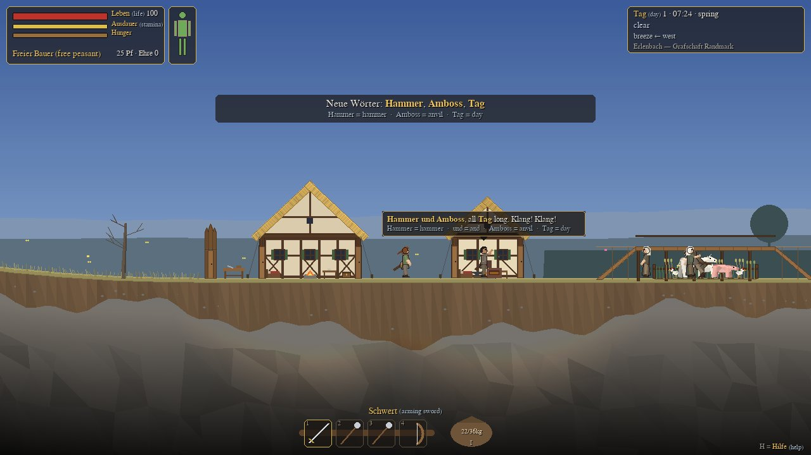

| | |
|---|---|
| 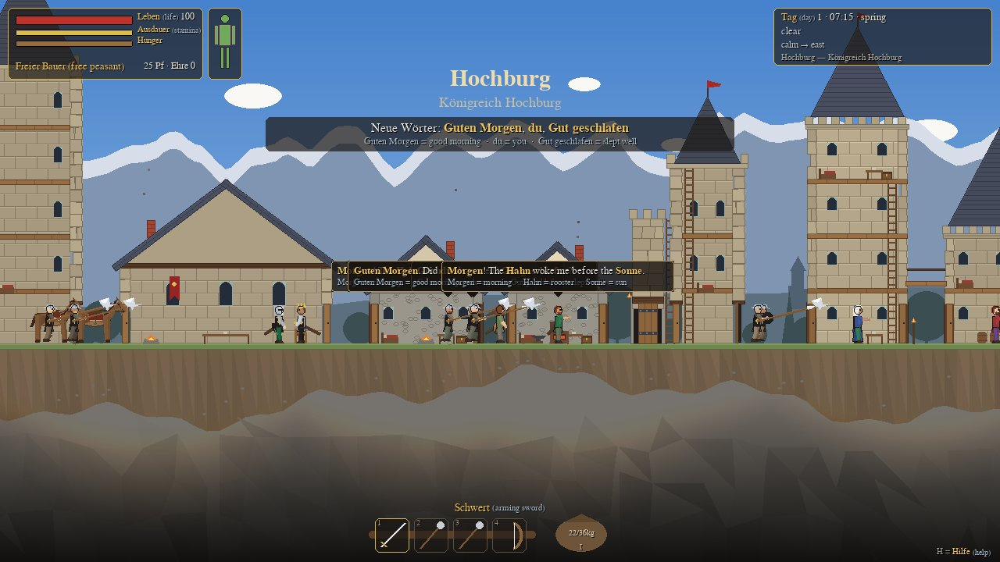 | 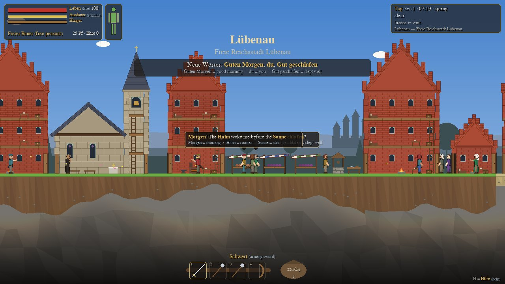 |
| 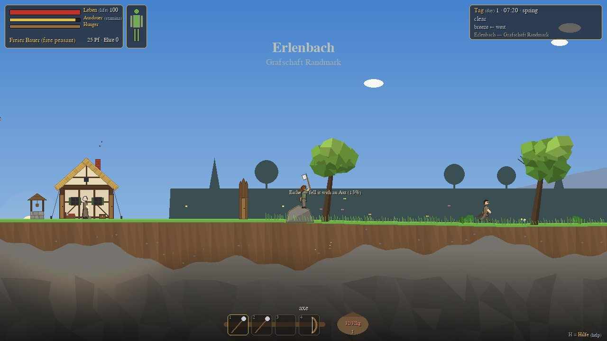 | 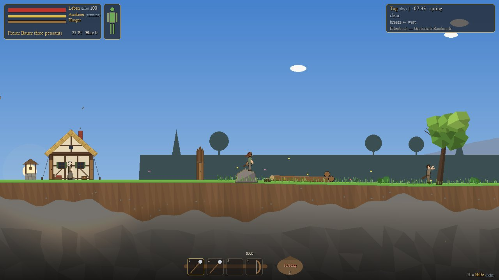 |
| 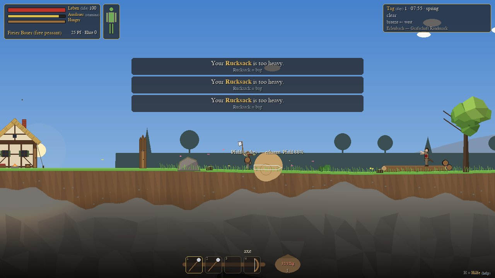 | 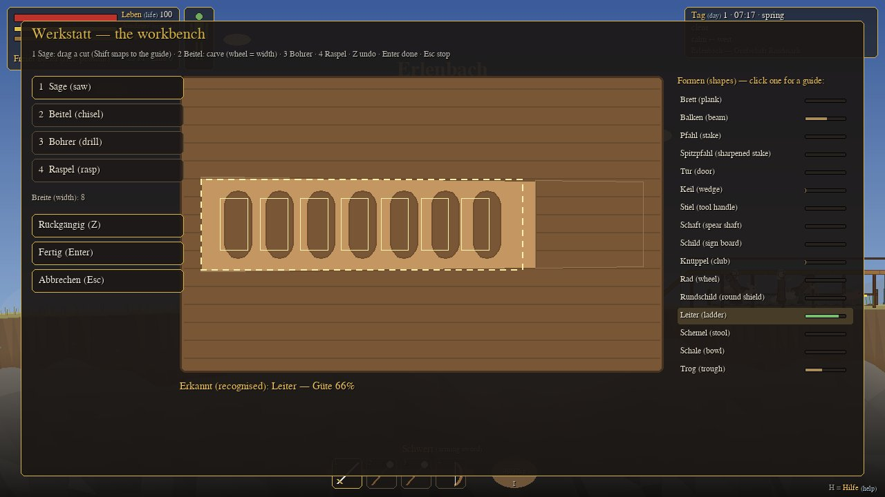 |
| 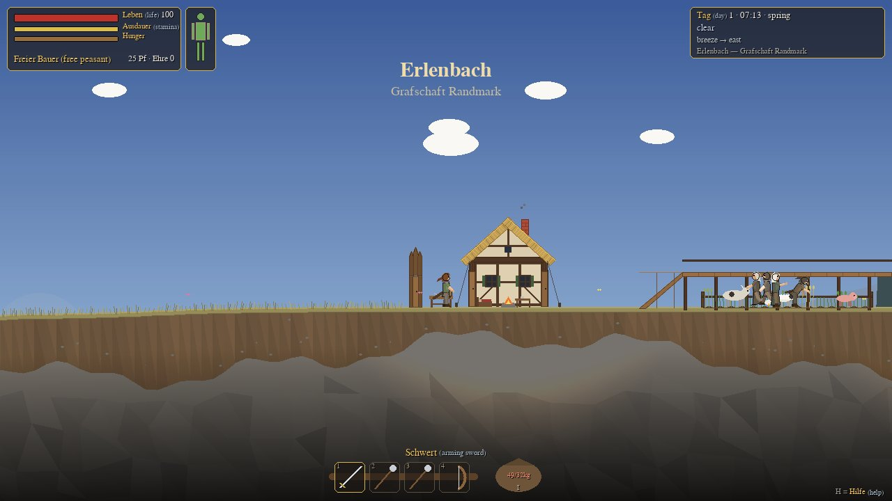 | 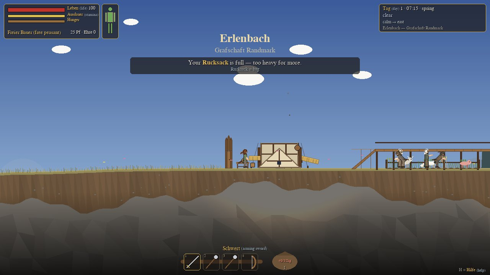 |
| 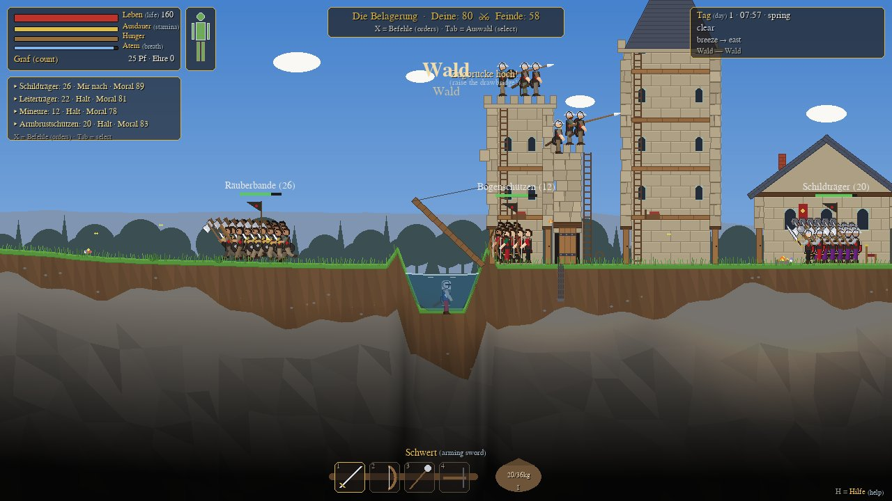 | 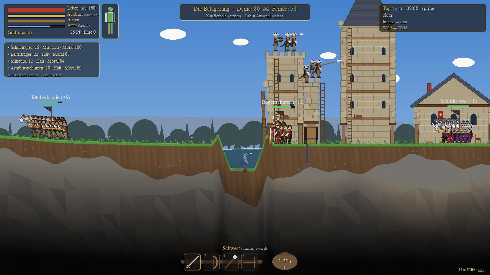 |
| 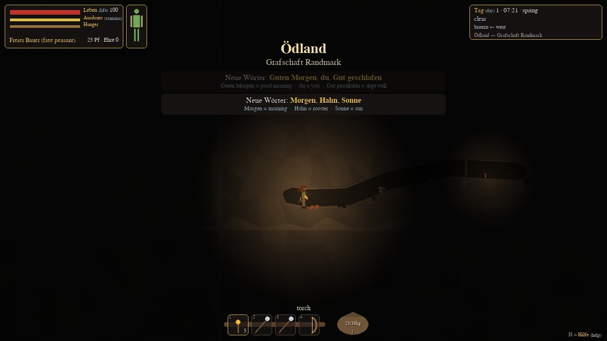 | 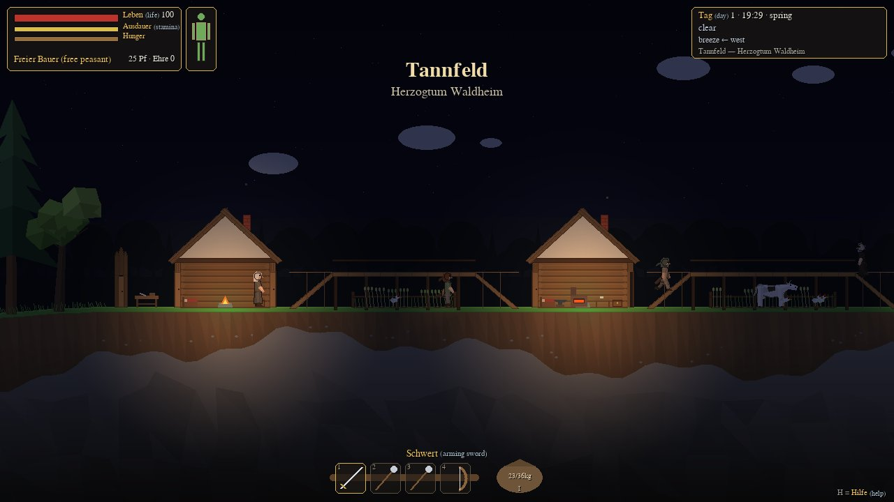 |
| 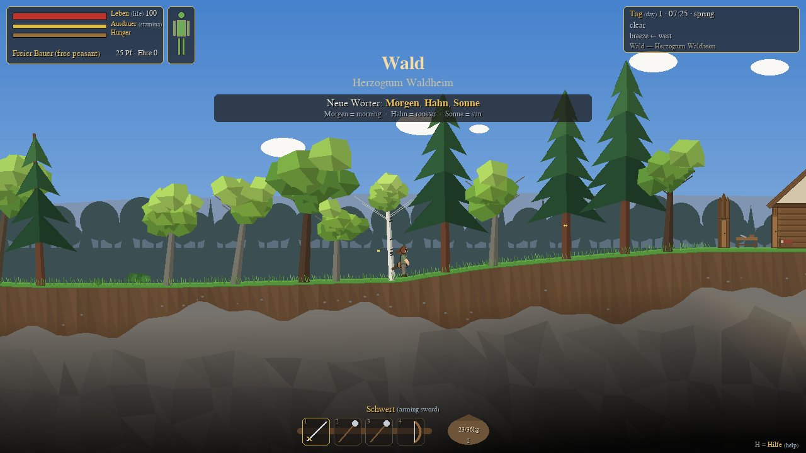 | 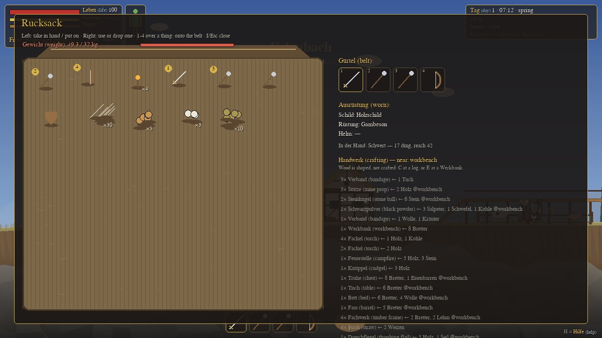 |

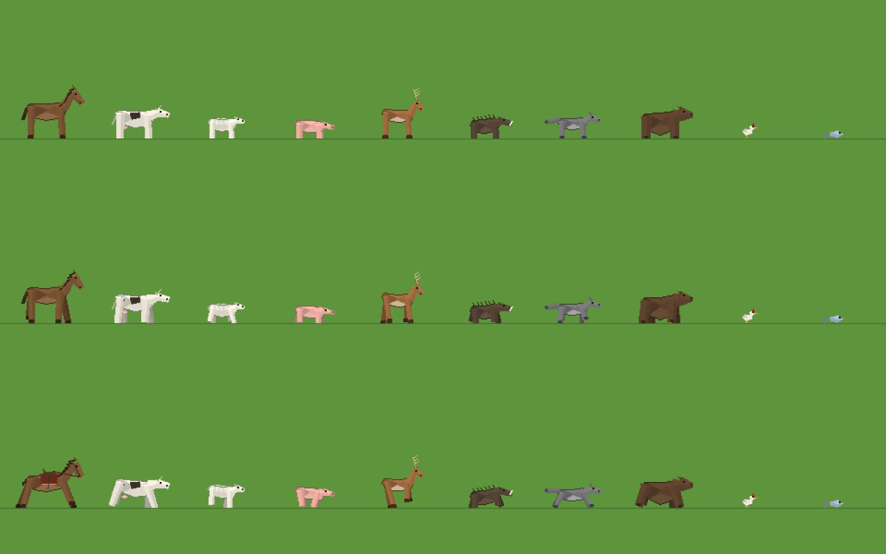

The block/tile-based version of round 2 is kept in [`legacy/tile_v2/`](legacy/tile_v2) for comparison.

## Run it

```bash
pip install pygame-ce numpy pymunk shapely
```

```bash
python main.py
```

Python 3.10+. Classic `pygame` 2.x also works. F11 toggles fullscreen, F3 shows the frame rate.

## Three ways to play

- **Geschichte** (Story) — *Die Chronik des Konrad*, 7 chapters: from serf of Erlenbach at the brink of the
  world, through the free city of Lübenau ("Stadtluft macht frei"), squire, knighthood, a voyage across the Grey
  Sea, a great battle and the election of the Kaiser — and why the Abyss keeps growing.
- **Sandkasten** (Sandbox) — the open world in three sizes (15 / 30 / 60 minutes of riding end to end).
- **Feldschlacht** (Field battle) — five set pieces: hold a ford, defend a mountain gate, an open battle of
  knights vs. pikes, storming a castle with engines, ladders and sappers, and defending one against powder
  guns.

## Controls

| Key | Action |
|---|---|
| A / D, Shift, S, Space, W | walk, run, crouch (run + crouch = slide), jump, climb / swim up |
| Left mouse / J | attack — the move depends on your state (see Combat) · with a tool or weapon on a **tree, trunk, wall or ore vein**: swing at it |
| Right mouse / K | block — tap it just before a hit lands to **parry** |
| E | pick up (small things go in the bag, big ones into your arms) · set down · doors and gates · chests · beds · **Werkbank** · talk · mount · board · harvest · pray · signposts · winch · pitch |
| Carrying | left click: set it down where you point · **Shift + click: fix it in place** (a door in a frame, stakes as a barrier, a plank bridge, a ladder) · R rotate · G throw |
| C | **shape the log at your feet**: Q / E choose a form, drag axe strokes along the dashed lines, Enter when done |
| 1–4 / mouse wheel | belt · Q drop · T cycle shield / armour / helmet · V fire arrows · click with a Verband to bind wounds, with a Hacke to till, with Mist to manure, with a Sichel to reap |
| I · B · M · N · R | the Rucksack & crafting · blueprints · world map · Wörterbuch (Q = quiz) · Ständeordnung |
| X · Tab · Z | formation orders · select formation · commander's zoomed-out view |
| F5 / F9 · Esc · H | save / load · pause · help |

## The polygon world (round 3)

- **No blocks.** The ground is a smooth surface over a crust of rock, drawn in faceted low-poly bands (turf,
  soil, rock strata). Caves are winding passages cut out of it with shapely, with ore veins in their walls (iron,
  coal, silver in Hochburg, salt, gold deep down, glowing *Glutstein* in Glutmark) and pale mushrooms. Water is
  a body with a level, waves and buoyancy; the Fire Sea and the Abyss are still at the ends of the world, and the
  brink still crumbles — now in rigid chunks that tumble into the void.
- **Real physics.** One pymunk space: people and animals are capsules with a hand-animated skeleton on top;
  logs, planks, debris, stones and everything you make are rigid bodies that roll, stack, float and burn. Doors
  are pieces that turn into sensors when they open; upper floors are one-way platforms you jump up through.
- **Buildings made of pieces.** A Fachwerk house is oak posts, plaster panels between rails and braces, plank
  floors, a thatched or tiled roof in two slabs over a framed gable, a chimney, doors. Stone keeps, town walls and
  bridges are coursed masonry, block by block, with battlements and voussoir arches. Each piece has a material
  (hardness, hit points, whether it burns) and a place in a **support graph**: what it rests on, what it is
  bonded to on each side. Break a piece and the graph is re-checked; whatever has lost its support becomes a
  rigid body and the physics engine decides how the wall or the roof comes down. Fire runs through timber,
  thatch and shingles piece by piece.
- **The few things you do with your hands:**
  - **Fell trees.** Chop with an axe; the trunk becomes a rigid body hinged on its stump and topples away from
    you — the crown crashes down, hurts whoever stands there, and scatters wood and saplings. Stumps regrow.
  - **Buck and carry.** Cut a lying trunk where you strike it. Small logs go in the bag; big ones you carry in
    both arms, slowly.
  - **Break structures.** Hammers and picks bite into walls, axes into timber; trebuchet stones and rams knock
    pieces out.
  - **Place what you made**, loose (it falls and settles) or fixed in place.
  - **Go underground** with a torch and a pick.
- **Shaping wood (procedural crafting).** You don't choose "door" from a menu; you cut one out of a piece of
  wood. A Werkstück is a polygon. *In the field*, press C at a log: the target shape is laid over it as dashed
  guide lines, and you make axe strokes along them with the mouse — fast strokes wobble, practice steadies your
  hand. *At a Werkbank* you work slowly and exactly: the **Säge** cuts straight through along a line you drag
  (Shift snaps to the guide), the **Beitel** carves grooves (the rungs of a ladder, the hollow of a trough), the
  **Bohrer** drills holes, the **Raspel** rounds edges, with undo. The result is compared with a library of known
  forms — Brett, Balken, Pfahl, Spitzpfahl, Tür, Keil, Stiel, Schaft, Knüppel, Schild, Rad, Rundschild, Leiter,
  Schemel, Schale, Trog — and the best fit and how closely you matched it decide what you made and its quality
  (Güte). Offcuts that happen to match a form are kept too. Anything that matches nothing is a *Rohling*, still a
  real object you can place. Shaped parts feed the smiths: a Stiel and iron make an axe, a Schaft makes a spear.
- **The Rucksack.** Like a real pack, not a grid of slots: things go in as they are, limited by weight (36 kg);
  opening it lays them out on a cloth as little piles. Four things hang on your **belt** within reach. Trunks,
  doors, ladders and beams don't fit in any bag — you carry them in your arms.
- **Animals with skeletons.** Horses, cattle, sheep, pigs, deer, boar, wolves and bears have four two-bone legs
  solved by inverse kinematics and real gaits — a four-beat walk, a diagonal trot, a rotary gallop with
  suspension. Hind legs fold at the hock, the body rocks, the neck nods, herd animals graze, horses wear saddle,
  blanket and bridle.
- **Ragdolls with joints.** The fallen become chains of rigid bones pinned at the joints with rotation limits;
  they drape over walls and logs and are frozen into still poses after a while to keep big battles cheap.

## What's in the world

**Seven realms of different sizes** (their rulers are the seven *Kurfürsten*, the electors):

| Realm | Type | Land | Ruler |
|---|---|---|---|
| Randmark | Grafschaft (county) | wasteland at the Abyss, meadows | Graf Randolf |
| Waldheim | Herzogtum (duchy) | deep forest, bog, a robber knight's castle | Herzog Eberhard |
| Hochburg | Königreich (kingdom) — the largest | mountains, silver mines, the crag-castle | König Albrecht |
| Heiligenstein | Fürstbistum (prince-bishopric) | vineyards, monastery, cathedral town | Fürstbischof Wolfram |
| Lübenau | Freie Reichsstadt (free city) | coast, port, salt | Bürgermeister Witte |
| Frostholm | Inselkönigreich (island kingdom) | across the Grey Sea: snow, fjords | Königin Sigrun |
| Glutmark | Markgrafschaft (march) | ash, basalt, volcanoes, the Fire Sea | Markgraf Otto der Rote |

- **A 1-hour ride** (768 000 px) generated in about a second: caves with ore veins, lakes, an ocean with a seabed
  full of seaweed, shells and shipwrecks with loot.
- **The ends of the world.** In the west the land is a crumbling slab hanging over the void, with floating stones
  above it and gravity that weakens near the brink. Fall in, and after a few seconds the sky drops you back into
  the world somewhere else. Enemies you knock into the Abyss sometimes come back the same way. In story mode the
  brink keeps crumbling. In the east a sea of lava pours off the edge.
- **Settlements, built from parts:** Fachwerk (timber-frame) houses with thatched or tiled roofs, two-storey
  burgher houses, churches with bell towers, windmills, smithies with anvil and forge, taverns, markets, wells,
  fields, palisades, town walls with gates, castles (keep, towers, curtain walls, great hall with throne and
  banners), monasteries, mine shafts, harbour docks, and signposts between villages.
- **A living environment:** day and night, four seasons, wind, clouds, rain, storms with lightning that sets trees
  alight, fog and snow. Crops ripen (faster in rain, never in winter), grass spreads, saplings grow into trees,
  orphaned leaves decay. Fire spreads through thatch and timber, faster downwind, and villagers run to put it out.
  Water and lava flow and turn into obsidian where they meet. Sand falls, and **built structures need support**:
  dig out a wall's foundation and it collapses (sapping).
- **The sea:** buy a *Kogge* (cog) in a port. Wind from behind fills the sail; against it you crawl or row. A
  full sail in a storm can capsize you. Swimming has buoyancy and breath, and heavy armour drags you down.
- **Every realm builds its own way:**
  - Hochburg's master builders stack their towns into **tower-houses joined by plank bridges** (a vertical
    city, like the patrician towers of Regensburg).
  - Lübenau builds in red brick with **stepped gables** (Backsteingotik).
  - Randmark **chains its houses to iron stakes**, because the crumbling edge takes whatever isn't anchored.
  - Waldheim builds log houses and keeps smoking charcoal kilns.
  - Frostholm lives in **turf-roofed longhouses**.
  - Glutmark half-buries **basalt houses** behind earth berms against the heat.
- **A world that has adapted:** villages lay **raised walkways over their fields**, because running feet and
  hooves trample the crops. **Stone bridges** cross lakes, **timber trestles** span mountain ravines, and
  vineyards are cut into terraces.
- **Farming:**
  - Crops: wheat, **rye** (the winter grain of the north), oats, flax (for linen) and turnips, each with its own
    growing seasons.
  - Soil fertility: every harvest tires the soil, fallow land (*Brache*) recovers, and manure restores it.
    Farmers practise crop rotation by leaving tired fields fallow.
  - Working the land: till with a hoe, or plough behind your horse (hold S while riding with a *Pflug*). Frost
    kills summer crops.
- **Seasons and life:** spring blossom, autumn colours and falling leaves, winter snow on every roof and bare
  trees. You'll also see birch woods, ferns, reeds by the water, heather, glacial boulders, flocks of birds,
  butterflies, fireflies on summer nights, and smoke from chimneys and kilns.
- **Building and crafting:** **blueprints** (huts, burgher houses, smithies, mills, wells, walls, gates,
  watchtowers, chapels, knights' halls, a whole castle) are raised piece by piece from the ground up; wood is
  shaped by hand (above); about 50 recipes at the Werkbank, Amboss + Esse, Ofen and Webstuhl cover the rest.

## Combat

**One button, several moves.** What your attack does depends on what you're doing:

| State | Move |
|---|---|
| standing | 3-hit combo: cut, backswing, heavy overhead |
| running | lunge / charge |
| crouching | low sweep, or a **Konter** (riposte) right after a successful block |
| in the air | plunging strike |
| on horseback | couched lance / riding slash, damage grows with speed |

Blocking costs stamina and posture. A **parry** (block in the last instant) staggers the attacker for free.
Crouching makes you a smaller target: high swings pass over you.

**Weapons that play differently:** the sword parries well · the axe smashes shields and fells trees · the mace
ignores armour · the dagger stabs ×3 into an unaware back · spears and pikes brace against charges (crouch + block)
but are clumsy up close · the halberd hooks riders off their horses · the flail wraps around shields · bows draw
with the mouse and drift on the wind (rain wets the string) · crossbows are slow but punch through mail · torches
light the dark and set thatch on fire. Armour (gambeson, mail, coat of plates) protects differently against cut,
pierce and blunt, and slows you down.

### Bodies, wounds and armour

Characters are **modular low-poly skeletons**: tapered, two-tone limbs on bones, driven by layered poses
(legs move, arms act, and the two blend smoothly). When someone dies, the same skeleton becomes a **verlet
ragdoll** of jointed rigid bones that tumbles down slopes and settles, and soldiers falling out of formation ranks do
the same.

Every hit lands on a **body part**, depending on the height of the blow, and armour protects only the parts it
covers, with a **hardness**:

| | head | torso | arms | legs |
|---|---|---|---|---|
| Gambeson (padded) | – | 2 | 2 | – |
| Kettenhemd (mail) | – | 5 | 5 | 4 |
| Plattenrock (plates) | – | 8 | 5 | 5 |
| Kettenhaube / Eisenhut / Beckenhaube / Topfhelm | 5 / 7 / 8 / 9 | | | |

Each weapon has a **penetration** value (sword 4, axe 5, dagger 6, bodkin arrow 5, crossbow bolt 8, powder ball
11). A cut that can't beat the hardness glances off ("Abgeprallt!"). Blunt weapons are the exception: padding
only softens them. As a result a sword does about 10% against plate, a mace about 75%, and a crossbow bolt goes
straight through mail. Wounds **bleed** until you bandage them (*Verband*):
- a wounded leg makes you limp (no running, then no jumping);
- a wounded sword arm weakens your blows, and a severe wound makes you drop the weapon;
- a wounded shield arm makes you drop the shield;
- head trauma dazes you, and a third head wound knocks you out.

Wounds heal with rest, or a priest or monk can tend them for a donation. The HUD shows a small body diagram.

## Sieges (Belagerung)

This is warfare against the world itself: walls are pieces in a support graph, so the physics decides what stands
and what falls.

- **Defences:** fortified castles have a **Graben** (moat), a **Zugbrücke** (drawbridge) and an iron
  **Fallgatter** (portcullis), plus open fighting tops on the towers and **Pechnasen** (machicolations). The
  defenders wind the drawbridge up on its chains (a kinematic body rotating on its hinge) and drop the portcullis when an enemy comes near, and pour **boiling pitch** on
  whatever reaches the gate. You can do the same with E at the winch or the Pechnase.
- **Ramps:** soldiers stuck in a moat shovel earth in front of them until they can climb out, so a moat is
  literally filled with men's work.
- **Sturmleitern:** ladder men raise real ladders against the wall and climb one by one. A defender at the
  top can **shove the ladder away**, and it falls as a rigid body. If the attackers hold the wall long enough, they open the gate from inside.
- **Mineure (sappers):** they dig a real tunnel under the wall, take its footing away and hold it up on timber
  props, then set the props on fire. When the props burn through, the wall has nothing left to stand on.
- **Engines:** the *Rammbock* (ram under a hide roof), the *Blide* (counterweight trebuchet throwing stones that
  break masonry), the *Belagerungsturm* (siege tower that lets a following Haufen onto the battlements) and the
  **Donnerbüchse**. That last one is an experimental powder gun, historically right on the edge for 1300, so only
  Glutmark has it, thanks to the sulphur of its volcanoes. It is loud and accurate, and sometimes it bursts.
  Engines are built from blueprints, burn under fire arrows, lose crew to missiles, and start or stop with E.
- **Battles:** *Die Belagerung* lets you storm a castle with all of the above, and *Die Verteidigung* has you hold
  one against Otto's engines and guns.

## Mid- to large-scale battles: the *Haufen*

A side view has no room for armies spread across a field, so the game borrows the historical **Gewalthaufen**: a
block of soldiers becomes **one formation entity**, drawn in several depth ranks (pseudo-3D). Only the **front
rank are real fighters** who duel the enemy front with the same combat rules as you. Behind them, every soldier is
a lightweight record that:

- **steps forward** when a front man falls, so the line holds as long as bodies remain;
- **rotates in** on *Wechsel!* so the wounded can rest (good troops do this by themselves);
- adds **pressure** (push of pike: the stronger block shoves the weaker back) and morale;
- extends **reach** (pike ranks 2 and 3 stab past the front);
- can be **shot by volleys**, **trampled by a charge**, or **cut down from behind** if you flank it.

Morale falls with losses, flanking and arrows, and recovers near the leader. When it breaks, the Haufen
**routs**. Formations that run into a gate or wall **hack through it** (siege). Hundreds of soldiers fight at
full frame rate, and Z gives you a zoomed-out commander's view.

**Orders, shouted in German:** *Vorwärts* (advance), *Halt* (hold), *Angriff* (charge), *Zurück* (fall back),
*Schildwall* (shield wall: arrows bounce off), *Igel* (hedgehog: braced pikes stop horses dead), *Keil* (wedge:
breaks lines), *Locker* (loose order: volleys miss), *Salve* (volley), *Wechsel* (rotate), *Mir nach* (follow
me), *Formiert euch* (your loose followers merge into a Haufen), *Auflösen* (disperse).

**Troop types:** peasant levy, spearmen, sword-and-shield men, pikemen, halberdiers, archers, crossbowmen with
pavises, mounted men-at-arms and knights. Each counters something and is countered by something.

## Society

- **NPCs live their lives:** they sleep in their own beds, work by day and gather at the tavern in the evening.
  Farmers really harvest and re-sow the strips of their fields, woodcutters fell real trees, smiths hammer, priests pray,
  guards patrol, and town gates open for friends and stay barred against enemies. Workers stay indoors in the rain, villagers fight fires,
  civilians flee from danger and guards fight. Each person has a name, a trade, a rank and a home. Only the people
  near you exist as full entities; everyone else lives on as a record (level-of-detail simulation).
- **Die Ständeordnung (the social order):** *Leibeigener* (serf) → *Freier Bauer* (free peasant) → *Bürger*
  (burgher) → *Knappe* (squire) → *Ritter* (knight) → *Freiherr* (baron) → *Graf* (count) → *Herzog* (duke) →
  *König / Kurfürst* (king / elector). The R screen explains each rank: what land it holds, what it owes, what it
  may do, why it exists, how people address it (*du* or *Ihr*) and how many soldiers it may lead. You climb by
  buying your freedom, buying citizenship, serving a knight, swearing fealty (*Lehnseid*) and being granted fiefs
  that pay you dues every day.
- **Economy:** every settlement has a market whose prices follow supply and demand. Each realm has its own
  specialities, and NPC production and caravans move goods between markets. You can trade, take jobs ("Gibt es
  Arbeit?"), hire men, or challenge fighters to a duel.
- **Politics:** realms declare war and make peace, and armies march across the map as abstract forces. When one
  comes near you it turns into real Haufen, and the defending town musters its own. Far from you, sieges are
  resolved on paper and towns change hands. Crimes such as theft, murder or poaching the duke's deer get you
  outlawed.

## Learning German — progressively

German appears **gradually**, using a method called the *diglot weave*:
- **Start:** about 20% of the vocabulary, the most important words, appears in German everywhere: UI labels,
  item names, NPC speech, messages. Each such word is shown with its English gloss: *Leben (life)*,
  *Ausdauer (stamina)*, *The Brot (bread) is fresh*.
- **Mastery:** once you have seen a word **10 times across at least 2 play sessions**, it is mastered. The
  English drops away and only *Brot* remains.
- **New words:** every mastered word brings a new one into the learning set, so the game slowly shifts from
  English into German as you play.
- **Persistence:** progress is stored in `saves/lexikon.json` and carries over between saves. Correct quiz answers
  count extra.

Beyond the weave, hand-written lines still mix in whole German phrases.

Dialogue mixes the two languages: *"[Guten Morgen], [Herr]! The [Brot] is fresh."* The German words are shown in
gold, with glosses underneath (Brot = bread). Every word you hear, read or pick up — item names, material names,
orders, chronicle pages — is recorded in your **Wörterbuch** with a count, and Q starts a flash-card quiz. NPCs
address you with *du* or the formal *Ihr* depending on your rank.

## Architecture

```
main.py                     entry point
warlord/
  settings.py               all tunables (world size, physics, palette)
  audio.py                  procedural sound bank (numpy-synthesised, no asset files)
  core/app.py               window, main loop, scenes, save/load (pickle + zlib)
  poly/                     world (terrain lines, caves, water, pymunk space, streaming) · gen (geography,
                            settlements, flora) · prefab (buildings from pieces, support graph, gatehouses)
                            materials · objects (rigid bodies) · flora (low-poly trees) · render
  world/                    noise · weather
  gfx/                      renderer (sky, parallax, camera) · rig (low-poly humanoid skeleton) · quadruped
                            (IK legs, gaits) · sprites · fx · ambient (birds, smoke…)
  entities/                 body (pymunk capsule) · humanoid · ragdoll (jointed rigid bones) · player · npc
                            (brains) · animals · boat · projectile
  combat/                   weapons · combat · injury · units · formation (Haufen) · siege
  society/                  kingdoms · ranks · names · dialogue (+ Wörterbuch) · lingua (progressive German)
                            society (people, markets, politics)
  items/                    items · inventory (the Rucksack) · shaping (procedural crafting) · crafting ·
                            blueprints
  modes/                    session (the running game) · world_ops (felling, breaking, fire, doors, fields,
                            carrying, placing) · player_ctrl (incl. field shaping) · story · battle
  ui/                       common · hud · bagui (the Rucksack view) · lab (the workbench) · menu
legacy/                     the original prototype · tile_v2/ the round-2 tile version
```

Key design decisions:
- **Controllers fill an `Intent`.** The keyboard, NPC brains and formations all drive the same `Humanoid` the same
  way, so a peasant, a knight and you fight by identical rules.
- **The physics body keeps the old interface.** `physics()` hands the wanted velocity to pymunk (projected along
  last step's contacts, so walls stop you and slopes guide you), the session steps the space once for everyone,
  and `post_step()` reads back position, ground contact and landings. That let the combat, brains, formations
  and story code survive the switch from tiles to polygons almost unchanged.
- **Streaming:** terrain segments and building pieces are added to the physics space only around the player
  (±2 700 px) and removed behind; the rest of the world is plain data.
- **Cached rendering:** terrain in 512 px tiles, each building in its own surface, rebuilt only when a piece
  changes; light is a coarse numpy grid (depth below the surface, water, point lights) multiplied over the scene.
- **Level-of-detail simulation:** people, livestock, boats and armies are records far away and entities nearby.
- **Session service API:** systems never reach into each other; they call the session (`hit_world`,
  `damage_piece`, `fell_tree`, `put_down`, `fire_arrow`, `npc_say`, `emit`...). Story and battle modes listen to
  events.

See [docs/COMPARISON.md](docs/COMPARISON.md) for how this compares to the original prototype, and
[docs/original_design_notes.txt](docs/original_design_notes.txt) for the first design notes.
